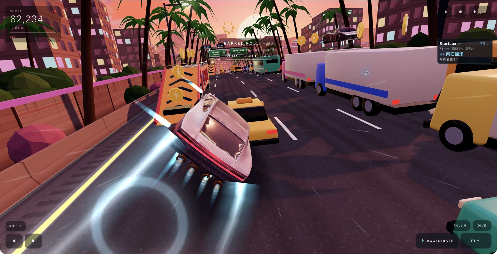
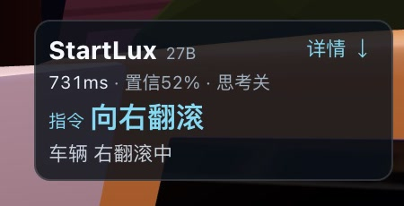
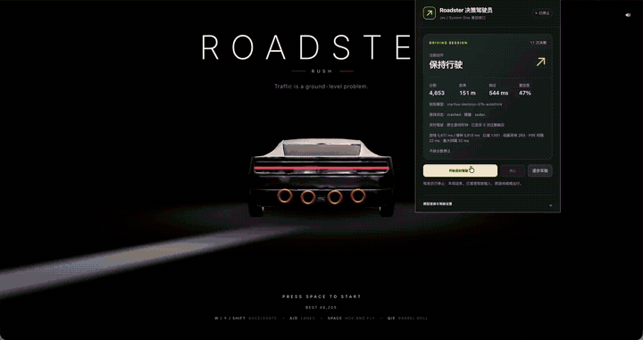

# Roadster StartLux Driver

[简体中文](README.md) · [English](README.en.md)

[](https://github.com/dctongsheng/roadster-startlux-driver/actions/workflows/ci.yml)
[](LICENSE)
[](https://github.com/dctongsheng/roadster-startlux-driver/releases/tag/v0.4.3)

**让 StartLux 实时驾驶，在游戏画面中看见模型、决策耗时和当前动作。**

这是一个用于 [Roadster Rush](https://roadster-rush.ai.studio/) 的 Chrome / Edge Manifest V3 扩展，连接 StartLux / System One 兼容决策服务。游戏保持原生实时运行，模型在后台异步决策；右侧小卡片把当前有效指令及车辆真实状态呈现在一起。当前版本 **0.4.3**。

## 实际运行演示



*本次使用公开版 0.4.3 插件实时驾驶的浏览器截图。卡片位于右侧上部，中央道路、车辆和原生操作区保持完整。*

| 当前指令有效 | 指令到期，等待下一次决策 |
| --- | --- |
|  |  |

*两张近景来自同一次真实浏览器运行：有效指令展示自己的响应参数；到期后清除动作，只保留明确标为「上次」的耗时与等待提示。*

### 游戏录屏

[](https://github.com/dctongsheng/roadster-startlux-driver/releases/download/v0.4.3/startlux-roadster-demo.mp4)

*上方插件截图与本段视频来自不同运行：视频是用户提供的游戏录屏，不包含决策卡片。点击动图观看带声音的完整视频。*

**[观看 / 下载游戏录屏 MP4](https://github.com/dctongsheng/roadster-startlux-driver/releases/download/v0.4.3/startlux-roadster-demo.mp4)** · [下载插件](https://github.com/dctongsheng/roadster-startlux-driver/releases/tag/v0.4.3)

## 你能实时看见什么

| 展示内容 | 含义 |
| --- | --- |
| **StartLux / 模型规模** | 突出当前响应的模型名称；服务返回名称带有 `27b` 等规模信息时显示对应标记 |
| **决策耗时 · ms** | 当前指令对应请求的客户端往返耗时，包含网络和服务端处理 |
| **当前指令** | 最新一条已接受、尚在提示时限内的模型选择，如翻滚、喷气或换道 |
| **原生车辆状态** | 独立读取实际翻滚方向、排队动作、换道以及喷气等输入保持状态 |
| **置信度 / 思考状态** | 显示接口返回的置信度和实际思考遥测；缺失信息如实标为未知 |

「指令」与「车辆」分别显示。例如，模型刚提交左翻滚时，车辆可能仍在完成右翻滚；卡片保留这个区别，不把指令回执当成动作完成。**ms 是请求往返耗时，不是纯推理耗时；置信度不是动作成功率。**

等待模型时游戏继续运行。新指令替换旧指令，提示时限到期立即清除；没有有效指令时收成一条轻提示，耗时会明确标为「上次」。停止接管或终局时隐藏卡片。详细预测、历史和审计记录留在游戏页面下方，点击「详情」才滚动过去。

扩展将完整的 **11 项动作及同口径条件预测**交给模型，原样提交仍然有效的模型选择。实时显示采用独立的 100 ms 只读采样，不额外调用模型或改变驾驶策略。[HUD 规则](docs/realtime-hud.md) · [架构与接口](docs/architecture.md)

本仓库提供浏览器扩展、测试和文档；模型后端、模型权重及 API Key 需自行准备。演示图片和视频来自实际游戏运行，第三方游戏素材的许可边界见[第三方说明](THIRD_PARTY_NOTICES.md)。服务返回的模型名是接口报告值，不证明具体权重来源、参数量或官方身份；本项目不是 Tesla、Roadster Rush 或模型服务的官方产品。

## 安装与驾驶

1. 从 [Releases](https://github.com/dctongsheng/roadster-startlux-driver/releases) 下载扩展 ZIP，或下载仓库源码 ZIP。也可运行：

   ```sh
   gh repo clone dctongsheng/roadster-startlux-driver
   cd roadster-startlux-driver
   ```

2. 使用当前稳定版 Chrome / Edge。解压 ZIP 后，在 Chrome 打开 `chrome://extensions`，或在 Edge 打开 `edge://extensions`。启用「开发者模式」，选择「加载已解压的扩展程序」，选中项目内的 **`extension` 目录**。
3. 打开 [Roadster Rush](https://roadster-rush.ai.studio/)，等待游戏加载完成。安装或更新扩展后，请刷新游戏标签页。
4. 点击工具栏扩展图标，填写 System One URL 和现有 API Key，保存设置。模型名称可留空，使用服务端默认值。
5. 可点击「测试模型连接」确认认证和响应格式。这会发送一次真实模型请求，可能产生模型用量；测试结果不执行游戏动作。
6. 确认「游戏时钟」为「实时驾驶」，点击「开始实时驾驶」。启动成功后弹窗自动关闭，右侧出现实时卡片；点击「详情」或向下滚动查看记录。
7. 要结束接管，重新打开扩展并点击「停止」。扩展取消在途请求并清理输入，原游戏继续运行。游戏终局时默认不自动重开。

保持游戏标签页处于前台。原游戏在窗口失焦或页面隐藏时可能主动暂停；扩展检测到原生暂停会退出接管。返回游戏后可再次点击开始。它与「逐步实验」主动冻结模拟是不同机制，详见[时钟边界](docs/architecture.md#时钟与暂停)。

## 受支持的接口

| 类型 | URL |
| --- | --- |
| 本机兼容服务 | `http://127.0.0.1:18080/v1/systemone` |
| 本机兼容服务 | `http://127.0.0.1:18081/v1/systemone` |
| 本机兼容服务 | `http://localhost:18080/v1/systemone`、`http://localhost:18081/v1/systemone` |
| TypeSafe HTTPS 接口 | `https://api.typesafe.ai/v1/systemone` |

路径必须精确为 `/v1/systemone`，不接受尾斜杠、查询参数、片段或 URL 内账号密码。HTTP 仅允许上表的本机主机和端口；HTTPS 仅允许 `api.typesafe.ai` 的默认 443 端口。任意远程服务器地址不在此发行版允许范围内。`127.0.0.1` / `localhost` 指安装插件的电脑；扩展不会自动启动本机服务或建立转发。

本机兼容服务默认关闭思考：UI 中的 `off / 0` 转为 `think_mode: "never"`、`think_budget: 1`。该服务必须支持这些字段；若响应明确报告仍在思考，扩展不执行该动作。官方 HTTPS 请求会移除兼容服务扩展字段，不承诺用本地思考开关控制该服务。[请求与响应示例](docs/architecture.md#模型协议)

## 默认设置

| 参数 | 默认值 | 含义 |
| --- | --- | --- |
| 游戏时钟 | `realtime` | 原生实时异步驾驶 |
| 普通输入保持 | `200 ms` | 范围 50–1000 ms；翻滚动作声明窗口约 533 ms |
| 最大观测时效 | `1500 ms` | 观测过旧时丢弃响应，不本地换选动作；当前弹窗不单独提供该项输入 |
| 最多决策次数 | `300` | 到达请求预算后结束接管 |
| 目标分数 | `0` | 不按分数停止；正数达标时仅结束驾驶输入 |
| 自动重开 | 关闭 | 需手动开启才能跨局继续 |
| 思考模式 / 预算 | `off / 0` | 本机兼容服务关闭思考 |

预测仅基于已观察对象与物理行为，可能因时延、交通反应和随机生成失准。指令提交不等于成功翻滚、换道或安全避障；本项目不承诺任何单局分数。

## 数据与权限

- API Key 只存于 `chrome.storage.session`，仅扩展受信任上下文可访问；不写入持久配置、页面卡片或导出记录。清除 Key 会停止驾驶并删除会话副本，浏览器会话结束后需重新输入。
- 其他连接和驾驶设置保存在 `chrome.storage.local`。运行状态会保存在扩展会话中，并在游戏页面内显示。
- 游戏遥测和动作题发送到所配置的模型接口，不发送截图或其他网页内容。服务端可能按自身规则归档请求。
- 下方列表默认只显示已提交指令；导出保留当前缓冲区内的未提交回执与审计字段，最多 200 条决策，并不代表无限历史。
- 权限为 `activeTab`、`scripting`、`storage`，主机范围见 [manifest.json](extension/manifest.json)。扩展仅适配指定游戏站点和上述接口白名单。

## 本地开发

需要 **Node.js 22+** 和 **Python 3**。没有 npm 第三方依赖，不需要安装依赖即可运行：

```sh
npm run check
npm test
npm run package
```

检查和单元测试不调用真实模型、不启动原游戏。打包生成 `dist/roadster-startlux-driver-v0.4.3.zip`，解压后仍选择其中的 `extension` 目录加载。原游戏内部接口变化后，适配可能失效；请提交不含 Key 的错误信息与复现步骤。

## 开源许可

本项目自有代码和文档采用 [MIT License](LICENSE)。第三方游戏、品牌与服务不因此取得 MIT 许可；详情见 [THIRD_PARTY_NOTICES.md](THIRD_PARTY_NOTICES.md)。
